# Dataset dictionary

**Lumen Analytics**: a fictional SaaS data platform with AI features. 32 tables in five domains, 113,515 rows in total. Generated deterministically by `scripts/generate_data.py` (seed 20250701, standard library only). This document is generated from `scripts/schema.py` and the CSV files by `scripts/build_workbook.py`, so it always matches the setup scripts.

## Conventions

- **Time:** all timestamps are UTC without a time-zone offset (`TIMESTAMP` in PostgreSQL, `DATETIME` in MySQL). The data covers 2023-02 to 2025-06-30; **"today" is 2025-07-01**. Questions use fixed dates instead of `CURRENT_DATE` so that results are reproducible.
- **NULL** means unknown or not applicable, as documented per column. The data never contains empty strings. In the CSV files an empty field is NULL.
- **Booleans:** `BOOLEAN` in both engines (MySQL stores TINYINT(1): TRUE = 1).
- **JSON:** `JSONB` in PostgreSQL, `JSON` in MySQL.
- **Money:** USD, `DECIMAL`. **Tokens:** integer counts. **Latency:** milliseconds.
- **Identifiers:** surrogate integer keys; IDs of time-ordered entities increase with their timestamp.
- **Intentional imperfections** are documented below under each table and in the summary at the end. They never violate a declared PRIMARY KEY, UNIQUE, FOREIGN KEY or CHECK constraint.

## Type mapping

| Neutral type | PostgreSQL | MySQL |
|---|---|---|
| TIMESTAMP | TIMESTAMP | DATETIME |
| JSON | JSONB | JSON |
| BOOLEAN | BOOLEAN | BOOLEAN (TINYINT(1)) |
| DOUBLE PRECISION | DOUBLE PRECISION | DOUBLE |
| DECIMAL(p,s), INT, BIGINT, SMALLINT, VARCHAR(n), CHAR(n), TEXT, DATE | same | same |

## Entity-relationship diagram

```mermaid
erDiagram
    organizations ||--o{ organizations : "parent_org_id (self)"
    organizations ||--o{ users : "org_id"
    users ||--o{ users : "referred_by_user_id (self)"
    organizations ||--o{ subscriptions : "org_id"
    plans ||--o{ subscriptions : "plan_id"
    product_categories ||--o{ product_categories : "parent_category_id (self)"
    product_categories ||--o{ products : "category_id"
    users ||--o{ orders : "user_id"
    organizations ||--o{ orders : "org_id"
    orders ||--o{ order_items : "order_id"
    products ||--o{ order_items : "product_id"
    orders ||--o{ payments : "order_id"
    organizations ||--o{ support_tickets : "org_id"
    users ||--o{ support_tickets : "user_id"
    users ||--o{ sessions : "user_id"
    users ||--o{ events : "user_id"
    sessions ||--o{ events : "session_id"
    experiments ||--o{ experiment_assignments : "experiment_id"
    users ||--o{ experiment_assignments : "user_id"
    users ||--o{ ml_entities : "user_id"
    organizations ||--o{ ml_entities : "org_id"
    ml_entities ||--o{ entity_features : "entity_id"
    ml_entities ||--o{ training_labels : "entity_id"
    model_versions ||--o{ model_versions : "parent_version_id (self)"
    model_versions ||--o{ model_predictions : "model_version_id"
    ml_entities ||--o{ model_predictions : "entity_id"
    model_versions ||--o{ model_evaluations : "model_version_id"
    documents ||--o{ document_chunks : "document_id"
    llm_models ||--o{ llm_pricing : "model_name"
    organizations ||--o{ llm_requests : "org_id"
    users ||--o{ llm_requests : "user_id"
    llm_models ||--o{ llm_requests : "model_name"
    prompts ||--o{ llm_requests : "prompt_version_id"
    retrieval_configs ||--o{ llm_requests : "retrieval_config_id"
    llm_requests ||--o{ llm_request_chunks : "request_id"
    document_chunks ||--o{ llm_request_chunks : "chunk_id"
    llm_requests ||--o{ ai_feedback : "request_id"
    users ||--o{ ai_feedback : "user_id"
    retrieval_configs ||--o{ retrieval_evaluations : "config_id"
    eval_queries ||--o{ retrieval_evaluations : "query_id"
    document_chunks ||--o{ retrieval_evaluations : "chunk_id"
```

## Tables

- **Core business:** [`plans`](#plans), [`organizations`](#organizations), [`users`](#users), [`subscriptions`](#subscriptions), [`product_categories`](#product-categories), [`products`](#products), [`orders`](#orders), [`order_items`](#order-items), [`payments`](#payments), [`support_tickets`](#support-tickets)
- **Product analytics:** [`sessions`](#sessions), [`events`](#events), [`experiments`](#experiments), [`experiment_assignments`](#experiment-assignments)
- **Machine learning:** [`ml_entities`](#ml-entities), [`entity_features`](#entity-features), [`training_labels`](#training-labels), [`model_versions`](#model-versions), [`model_predictions`](#model-predictions), [`model_evaluations`](#model-evaluations)
- **AI / LLM applications:** [`documents`](#documents), [`document_chunks`](#document-chunks), [`llm_models`](#llm-models), [`llm_pricing`](#llm-pricing), [`prompts`](#prompts), [`retrieval_configs`](#retrieval-configs), [`llm_requests`](#llm-requests), [`llm_request_chunks`](#llm-request-chunks), [`ai_feedback`](#ai-feedback), [`eval_queries`](#eval-queries), [`retrieval_evaluations`](#retrieval-evaluations)
- **Platform operations:** [`pipeline_runs`](#pipeline-runs)

### plans

Catalogue of subscription plans. Prices are per seat per month in USD.

- **Grain:** One row per subscription plan.
- **Rows:** 6
- **Primary key:** (plan_id)
- **Unique:** (plan_name)
- **Checks:** `price_per_seat_month >= 0`; `tier_rank BETWEEN 0 AND 4`
- **Secondary indexes:** none (primary/unique keys only)

| Column | PostgreSQL type | MySQL type | Null? | Description | Units / allowed values | Observed (non-NULL) | NULL % |
|---|---|---|---|---|---|---|---:|
| `plan_id` | INT | INT | NOT NULL | Surrogate key. |  | 1 … 6 | 0.0% |
| `plan_name` | VARCHAR(30) | VARCHAR(30) | NOT NULL | Display name of the plan. |  | 6 distinct: `Free`, `Starter`, `Pro`, `Business`, `Enterprise`, `Pro (Legacy)` | 0.0% |
| `tier_rank` | SMALLINT | SMALLINT | NOT NULL | Ordinal tier (0 = Free ... 4 = Enterprise). Legacy plans share the rank of the plan they map to. | 0-4 | 0 … 4 | 0.0% |
| `price_per_seat_month` | DECIMAL(10,2) | DECIMAL(10,2) | NOT NULL | List price per seat per month. | USD, 0-89 | 0 … 89 | 0.0% |
| `annual_discount_pct` | DECIMAL(5,2) | DECIMAL(5,2) | NULL | Discount applied to annual billing. NULL = annual billing not offered. | 0-20 (%) | 15 … 20 | 16.7% |
| `seat_limit` | INT | INT | NULL | Maximum seats. NULL = unlimited. | 1-500 | 3 … 200 | 16.7% |
| `is_active` | BOOLEAN | BOOLEAN | NOT NULL | FALSE for legacy plans that can no longer be purchased. |  | true 5 / false 1 | 0.0% |
| `launched_on` | DATE | DATE | NOT NULL | Date the plan became available. |  | 2021-03-01 … 2023-04-01 | 0.0% |

**Business rules and notes**

- `Pro (Legacy)` is inactive but still referenced by old subscriptions.

### organizations

Customer organizations. Subsidiaries point to their parent organization.

- **Grain:** One row per customer organization (account).
- **Rows:** 200
- **Primary key:** (org_id)
- **Foreign keys:** (parent_org_id) → organizations(org_id)
- **Checks:** `segment IN ('SMB','Mid-Market','Enterprise')`; `deleted_at IS NULL OR is_deleted = TRUE`
- **Secondary indexes:** ix_organizations_parent_org_id (parent_org_id)

| Column | PostgreSQL type | MySQL type | Null? | Description | Units / allowed values | Observed (non-NULL) | NULL % |
|---|---|---|---|---|---|---|---:|
| `org_id` | INT | INT | NOT NULL | Surrogate key. |  | 1 … 200 | 0.0% |
| `org_name` | VARCHAR(120) | VARCHAR(120) | NOT NULL | Organization name. |  | 198 distinct | 0.0% |
| `parent_org_id` | INT | INT | NULL | Parent organization for subsidiaries; NULL for top-level orgs. Hierarchies are up to 3 levels deep. |  | 8 … 100 | 89.0% |
| `industry` | VARCHAR(40) | VARCHAR(40) | NULL | Industry vertical. NULL = not captured during sign-up. |  | 10 distinct | 4.0% |
| `segment` | VARCHAR(20) | VARCHAR(20) | NOT NULL | Sales segment. | 'SMB','Mid-Market','Enterprise' | 3 distinct: `SMB`, `Mid-Market`, `Enterprise` | 0.0% |
| `employee_band` | VARCHAR(20) | VARCHAR(20) | NULL | Company size band. NULL = unknown. | '1-10','11-50','51-200','201-1000','1000+' | 5 distinct: `11-50`, `51-200`, `1-10`, `201-1000`, `1000+` | 8.0% |
| `country_code` | CHAR(2) | CHAR(2) | NOT NULL | ISO-3166 alpha-2 country of the billing address. |  | 10 distinct | 0.0% |
| `timezone` | VARCHAR(40) | VARCHAR(40) | NOT NULL | IANA time zone of the organization's headquarters. |  | 12 distinct | 0.0% |
| `created_at` | TIMESTAMP | DATETIME | NOT NULL | Account creation time (UTC). |  | 2023-02-04 … 2025-05-28 | 0.0% |
| `is_deleted` | BOOLEAN | BOOLEAN | NOT NULL | Soft-delete flag. |  | true 10 / false 190 | 0.0% |
| `deleted_at` | TIMESTAMP | DATETIME | NULL | Soft-delete time (UTC). Set only when is_deleted is TRUE. |  | 2024-06-20 … 2025-05-28 | 95.0% |

**Business rules and notes**

- Organization names are not unique; two different companies can share a name.
- Soft-deleted organizations keep their history (users, orders, tickets).

### users

Users belong to exactly one organization. Some people registered twice with differently formatted e-mails.

- **Grain:** One row per user account (login). A real person may have more than one account.
- **Rows:** 1,782
- **Primary key:** (user_id)
- **Foreign keys:** (org_id) → organizations(org_id); (referred_by_user_id) → users(user_id)
- **Checks:** `role IN ('admin','member','viewer')`; `status IN ('active','inactive','deleted')`
- **Secondary indexes:** ix_users_org_id (org_id); ix_users_signup_at (signup_at)

| Column | PostgreSQL type | MySQL type | Null? | Description | Units / allowed values | Observed (non-NULL) | NULL % |
|---|---|---|---|---|---|---|---:|
| `user_id` | INT | INT | NOT NULL | Surrogate key. Increases with signup_at. |  | 1 … 1,782 | 0.0% |
| `org_id` | INT | INT | NOT NULL | Organization the user belongs to. |  | 1 … 200 | 0.0% |
| `email` | VARCHAR(255) | VARCHAR(255) | NOT NULL | Login e-mail exactly as typed. Not normalized: case and surrounding spaces vary. |  | 1,782 distinct | 0.0% |
| `full_name` | VARCHAR(120) | VARCHAR(120) | NOT NULL | Display name (may contain non-ASCII characters). |  | 1,160 distinct | 0.0% |
| `role` | VARCHAR(20) | VARCHAR(20) | NOT NULL | Role inside the organization. | 'admin','member','viewer' | 3 distinct: `member`, `viewer`, `admin` | 0.0% |
| `signup_at` | TIMESTAMP | DATETIME | NOT NULL | Registration time (UTC). |  | 2023-02-04 … 2025-06-29 | 0.0% |
| `last_login_at` | TIMESTAMP | DATETIME | NULL | Most recent login (UTC). NULL = never logged in after signup. |  | 2023-02-05 … 2025-06-30 | 11.1% |
| `status` | VARCHAR(20) | VARCHAR(20) | NOT NULL | Account status. | 'active','inactive','deleted' | 3 distinct: `active`, `inactive`, `deleted` | 0.0% |
| `acquisition_channel` | VARCHAR(30) | VARCHAR(30) | NULL | Marketing channel that acquired the user. NULL = unknown/untracked. | 'organic','paid_search','referral','social','partner' | 5 distinct: `organic`, `paid_search`, `referral`, `partner`, `social` | 8.5% |
| `country_code` | CHAR(2) | CHAR(2) | NULL | Country inferred from the signup IP. NULL = could not be resolved. |  | 10 distinct | 3.0% |
| `referred_by_user_id` | INT | INT | NULL | User who referred this user (self-reference). NULL = not referred. |  | 2 … 1,711 | 86.8% |
| `marketing_opt_in` | BOOLEAN | BOOLEAN | NULL | Consent to marketing e-mails. NULL = never asked (three-valued). |  | true 705 / false 777 | 16.8% |

**Business rules and notes**

- `email` is intentionally NOT unique: about 1.5% of people have a duplicate account whose e-mail differs only in letter case and/or leading/trailing spaces.
- A referrer always signed up before the user they referred.

### subscriptions

Organization-level subscription history. A plan change ends one row and starts another.

- **Grain:** One row per subscription period of an organization on one plan.
- **Rows:** 367
- **Primary key:** (subscription_id)
- **Foreign keys:** (org_id) → organizations(org_id); (plan_id) → plans(plan_id)
- **Checks:** `seats > 0`; `mrr >= 0`; `ended_at IS NULL OR ended_at >= started_at`; `status IN ('trialing','active','past_due','canceled','switched')`; `billing_cycle IN ('monthly','annual')`
- **Secondary indexes:** ix_subscriptions_org_id_started_at (org_id, started_at); ix_subscriptions_plan_id (plan_id)

| Column | PostgreSQL type | MySQL type | Null? | Description | Units / allowed values | Observed (non-NULL) | NULL % |
|---|---|---|---|---|---|---|---:|
| `subscription_id` | INT | INT | NOT NULL | Surrogate key. |  | 1 … 367 | 0.0% |
| `org_id` | INT | INT | NOT NULL | Subscribing organization. |  | 1 … 200 | 0.0% |
| `plan_id` | INT | INT | NOT NULL | Plan for this period. |  | 1 … 6 | 0.0% |
| `status` | VARCHAR(20) | VARCHAR(20) | NOT NULL | Lifecycle status. 'switched' = ended because the org moved to another plan; 'canceled' = ended because the org churned. | 'trialing','active','past_due','canceled','switched' | 5 distinct: `switched`, `active`, `canceled`, `past_due`, `trialing` | 0.0% |
| `billing_cycle` | VARCHAR(10) | VARCHAR(10) | NOT NULL | Billing frequency. | 'monthly','annual' | 2 distinct: `monthly`, `annual` | 0.0% |
| `seats` | INT | INT | NOT NULL | Number of paid seats. | 1-400 | 1 … 354 | 0.0% |
| `mrr` | DECIMAL(10,2) | DECIMAL(10,2) | NOT NULL | Monthly recurring revenue for this period (seats x price, after annual discount). | USD | 0 … 3.151e+04 | 0.0% |
| `started_at` | TIMESTAMP | DATETIME | NOT NULL | Period start (UTC, inclusive). |  | 2023-02-04 … 2025-06-29 | 0.0% |
| `ended_at` | TIMESTAMP | DATETIME | NULL | Period end (UTC, exclusive). NULL = still open. |  | 2023-04-22 … 2025-06-29 | 44.7% |
| `cancel_reason` | VARCHAR(50) | VARCHAR(50) | NULL | Reason given on cancellation. Only for status 'canceled'; may still be NULL when the customer gave no reason. |  | 4 distinct: `too_expensive`, `missing_feature`, `no_longer_needed`, `switched_competitor` | 90.5% |

**Business rules and notes**

- Open periods (`ended_at IS NULL`) have status 'trialing', 'active' or 'past_due'.
- INTENTIONAL DATA-QUALITY ISSUE: a handful of organizations have overlapping subscription periods caused by a billing-system bug.
- Some organizations churn (canceled) and come back later, leaving a gap between periods.

### product_categories

Category tree (up to 3 levels).

- **Grain:** One row per product category node.
- **Rows:** 11
- **Primary key:** (category_id)
- **Foreign keys:** (parent_category_id) → product_categories(category_id)
- **Unique:** (category_name)
- **Secondary indexes:** none (primary/unique keys only)

| Column | PostgreSQL type | MySQL type | Null? | Description | Units / allowed values | Observed (non-NULL) | NULL % |
|---|---|---|---|---|---|---|---:|
| `category_id` | INT | INT | NOT NULL | Surrogate key. |  | 1 … 11 | 0.0% |
| `category_name` | VARCHAR(60) | VARCHAR(60) | NOT NULL | Category name. |  | 11 distinct | 0.0% |
| `parent_category_id` | INT | INT | NULL | Parent node; NULL for root categories. |  | 1 … 9 | 27.3% |

**Business rules and notes**

- Products are attached to leaf categories.

### products

One-off products sold through orders (subscriptions are billed separately).

- **Grain:** One row per sellable product (add-ons, credit packs, services).
- **Rows:** 36
- **Primary key:** (product_id)
- **Foreign keys:** (category_id) → product_categories(category_id)
- **Unique:** (product_name)
- **Checks:** `list_price >= 0`
- **Secondary indexes:** ix_products_category_id (category_id)

| Column | PostgreSQL type | MySQL type | Null? | Description | Units / allowed values | Observed (non-NULL) | NULL % |
|---|---|---|---|---|---|---|---:|
| `product_id` | INT | INT | NOT NULL | Surrogate key. |  | 1 … 36 | 0.0% |
| `product_name` | VARCHAR(80) | VARCHAR(80) | NOT NULL | Product name. |  | 36 distinct | 0.0% |
| `category_id` | INT | INT | NOT NULL | Leaf category. |  | 2 … 11 | 0.0% |
| `list_price` | DECIMAL(10,2) | DECIMAL(10,2) | NOT NULL | Current list price per unit. | USD | 15 … 1.2e+04 | 0.0% |
| `is_active` | BOOLEAN | BOOLEAN | NOT NULL | FALSE = discontinued (still present in historical orders). |  | true 33 / false 3 | 0.0% |
| `launched_on` | DATE | DATE | NOT NULL | Launch date. |  | 2020-06-01 … 2025-01-15 | 0.0% |

**Business rules and notes**

- Order lines can be sold below list price (negotiated discounts).

### orders

Orders for one-off products. `order_total` is a denormalized header amount.

- **Grain:** One row per order (checkout).
- **Rows:** 1,560
- **Primary key:** (order_id)
- **Foreign keys:** (user_id) → users(user_id); (org_id) → organizations(org_id)
- **Checks:** `order_total >= 0`; `status IN ('completed','pending','canceled','refunded')`
- **Secondary indexes:** ix_orders_user_id_order_ts (user_id, order_ts); ix_orders_order_ts (order_ts); ix_orders_org_id (org_id)

| Column | PostgreSQL type | MySQL type | Null? | Description | Units / allowed values | Observed (non-NULL) | NULL % |
|---|---|---|---|---|---|---|---:|
| `order_id` | INT | INT | NOT NULL | Surrogate key. Increases with order_ts. |  | 1 … 1,560 | 0.0% |
| `user_id` | INT | INT | NOT NULL | Purchasing user. |  | 17 … 1,782 | 0.0% |
| `org_id` | INT | INT | NOT NULL | Organization billed (denormalized copy of users.org_id at order time). |  | 5 … 200 | 0.0% |
| `order_ts` | TIMESTAMP | DATETIME | NOT NULL | Order time (UTC). |  | 2024-01-16 … 2025-06-30 | 0.0% |
| `status` | VARCHAR(20) | VARCHAR(20) | NOT NULL | Order status. | 'completed','pending','canceled','refunded' | 4 distinct: `completed`, `refunded`, `canceled`, `pending` | 0.0% |
| `sales_channel` | VARCHAR(20) | VARCHAR(20) | NOT NULL | Where the order was placed. | 'web','sales','marketplace' | 3 distinct: `web`, `sales`, `marketplace` | 0.0% |
| `discount_code` | VARCHAR(20) | VARCHAR(20) | NULL | Promotion code. NULL = none. |  | 5 distinct: `PARTNER15`, `WELCOME10`, `BF2024`, `SUMMER25`, `SPRING24` | 84.7% |
| `order_total` | DECIMAL(12,2) | DECIMAL(12,2) | NOT NULL | Header total in USD as recorded by the checkout service. | USD | 12.75 … 6.1e+04 | 0.0% |

**Business rules and notes**

- Revenue analyses normally use `status = 'completed'` orders only.
- INTENTIONAL DATA-QUALITY ISSUE: about 2% of orders have an `order_total` that differs from the sum of their order lines (a rounding bug in an old checkout version).
- A few orders carry an `org_id` different from the purchasing user's: some are legitimately billed to the parent company, others are INTENTIONAL DATA-QUALITY ISSUES (unrelated organization).
- About half of all users never place an order.

### order_items

Order lines. Composite primary key (order_id, line_number).

- **Grain:** One row per order line.
- **Rows:** 2,518
- **Primary key:** (order_id, line_number)
- **Foreign keys:** (order_id) → orders(order_id); (product_id) → products(product_id)
- **Checks:** `quantity > 0`; `unit_price >= 0`; `discount_amount >= 0`
- **Secondary indexes:** ix_order_items_product_id (product_id)

| Column | PostgreSQL type | MySQL type | Null? | Description | Units / allowed values | Observed (non-NULL) | NULL % |
|---|---|---|---|---|---|---|---:|
| `order_id` | INT | INT | NOT NULL | Parent order. |  | 1 … 1,560 | 0.0% |
| `line_number` | SMALLINT | SMALLINT | NOT NULL | 1-based line number within the order. | 1-4 | 1 … 4 | 0.0% |
| `product_id` | INT | INT | NOT NULL | Product sold. |  | 1 … 36 | 0.0% |
| `quantity` | INT | INT | NOT NULL | Units. | 1-50 | 1 … 12 | 0.0% |
| `unit_price` | DECIMAL(10,2) | DECIMAL(10,2) | NOT NULL | Price per unit actually charged. | USD | 11.25 … 1.2e+04 | 0.0% |
| `discount_amount` | DECIMAL(10,2) | DECIMAL(10,2) | NOT NULL | Line-level discount in USD (0 when none). | USD | 0 … 1,800 | 0.0% |

**Business rules and notes**

- Line revenue = quantity * unit_price - discount_amount.

### payments

Payment attempts against orders. Failed attempts are retried as new rows.

- **Grain:** One row per payment attempt.
- **Rows:** 1,685
- **Primary key:** (payment_id)
- **Foreign keys:** (order_id) → orders(order_id)
- **Checks:** `amount >= 0`; `status IN ('succeeded','failed','pending','refunded')`
- **Secondary indexes:** ix_payments_order_id (order_id)

| Column | PostgreSQL type | MySQL type | Null? | Description | Units / allowed values | Observed (non-NULL) | NULL % |
|---|---|---|---|---|---|---|---:|
| `payment_id` | INT | INT | NOT NULL | Surrogate key. |  | 1 … 1,685 | 0.0% |
| `order_id` | INT | INT | NOT NULL | Order being paid. |  | 1 … 1,560 | 0.0% |
| `attempted_at` | TIMESTAMP | DATETIME | NOT NULL | Attempt time (UTC). |  | 2024-01-16 … 2025-06-30 | 0.0% |
| `amount` | DECIMAL(12,2) | DECIMAL(12,2) | NOT NULL | Amount attempted. | USD | 12.75 … 6.1e+04 | 0.0% |
| `method` | VARCHAR(20) | VARCHAR(20) | NOT NULL | Payment method. | 'card','bank_transfer','paypal','invoice' | 4 distinct: `card`, `bank_transfer`, `invoice`, `paypal` | 0.0% |
| `status` | VARCHAR(20) | VARCHAR(20) | NOT NULL | Attempt outcome. 'refunded' = succeeded and later (partly) refunded. | 'succeeded','failed','pending','refunded' | 4 distinct: `succeeded`, `failed`, `refunded`, `pending` | 0.0% |
| `failure_reason` | VARCHAR(40) | VARCHAR(40) | NULL | Only for failed attempts. |  | 4 distinct: `card_declined`, `network_error`, `insufficient_funds`, `expired_card` | 85.1% |
| `refunded_amount` | DECIMAL(12,2) | DECIMAL(12,2) | NULL | Amount refunded; only for status 'refunded'. Can be a partial refund. | USD | 5.63 … 1.205e+04 | 93.4% |
| `refunded_at` | TIMESTAMP | DATETIME | NULL | Refund time (UTC). |  | 2024-04-21 … 2025-06-30 | 93.4% |

**Business rules and notes**

- A completed order normally has exactly one 'succeeded' payment, possibly preceded by failed attempts.
- INTENTIONAL DATA-QUALITY ISSUE: a small number of completed orders have no payment row at all (invoice not yet recorded).

### support_tickets

Customer support tickets.

- **Grain:** One row per support ticket.
- **Rows:** 1,359
- **Primary key:** (ticket_id)
- **Foreign keys:** (org_id) → organizations(org_id); (user_id) → users(user_id)
- **Checks:** `csat_score IS NULL OR csat_score BETWEEN 1 AND 5`
- **Secondary indexes:** ix_support_tickets_org_id_created_at (org_id, created_at); ix_support_tickets_user_id (user_id)

| Column | PostgreSQL type | MySQL type | Null? | Description | Units / allowed values | Observed (non-NULL) | NULL % |
|---|---|---|---|---|---|---|---:|
| `ticket_id` | INT | INT | NOT NULL | Surrogate key. |  | 1 … 1,359 | 0.0% |
| `org_id` | INT | INT | NOT NULL | Customer organization. |  | 4 … 199 | 0.0% |
| `user_id` | INT | INT | NULL | Requesting user. NULL = ticket arrived by e-mail from an unknown sender. |  | 14 … 1,773 | 9.0% |
| `created_at` | TIMESTAMP | DATETIME | NOT NULL | Ticket creation (UTC). |  | 2024-01-01 … 2025-06-30 | 0.0% |
| `first_response_at` | TIMESTAMP | DATETIME | NULL | First agent response (UTC). NULL = not yet answered. |  | 2024-01-02 … 2025-06-30 | 0.4% |
| `resolved_at` | TIMESTAMP | DATETIME | NULL | Resolution time (UTC). NULL = unresolved. |  | 2024-01-04 … 2025-06-29 | 2.4% |
| `priority` | VARCHAR(10) | VARCHAR(10) | NOT NULL | Priority. | 'low','medium','high','urgent' | 4 distinct: `medium`, `low`, `high`, `urgent` | 0.0% |
| `category` | VARCHAR(30) | VARCHAR(30) | NOT NULL | Topic. | 'billing','bug','how_to','feature_request','account','ai_quality' | 6 distinct: `how_to`, `bug`, `billing`, `feature_request`, `account`, `ai_quality` | 0.0% |
| `status` | VARCHAR(20) | VARCHAR(20) | NOT NULL | Current status. | 'open','pending','resolved','closed' | 4 distinct: `closed`, `resolved`, `pending`, `open` | 0.0% |
| `channel` | VARCHAR(20) | VARCHAR(20) | NOT NULL | Intake channel. | 'email','chat','phone','web_form' | 4 distinct: `email`, `chat`, `web_form`, `phone` | 0.0% |
| `csat_score` | SMALLINT | SMALLINT | NULL | Customer satisfaction 1-5 from the post-resolution survey. NULL = no survey answer. | 1-5 | 1 … 5 | 56.5% |

**Business rules and notes**

- `resolved_at` is set for status 'resolved' and 'closed'.

### sessions

Client sessions in the web/mobile application.

- **Grain:** One row per application session.
- **Rows:** 14,449
- **Primary key:** (session_id)
- **Foreign keys:** (user_id) → users(user_id)
- **Checks:** `ended_at IS NULL OR ended_at >= started_at`
- **Secondary indexes:** ix_sessions_user_id_started_at (user_id, started_at)

| Column | PostgreSQL type | MySQL type | Null? | Description | Units / allowed values | Observed (non-NULL) | NULL % |
|---|---|---|---|---|---|---|---:|
| `session_id` | INT | INT | NOT NULL | Surrogate key. |  | 1 … 14,449 | 0.0% |
| `user_id` | INT | INT | NOT NULL | Session owner. |  | 1 … 1,782 | 0.0% |
| `started_at` | TIMESTAMP | DATETIME | NOT NULL | Session start (UTC). |  | 2023-02-04 … 2025-06-30 | 0.0% |
| `ended_at` | TIMESTAMP | DATETIME | NULL | Session end (UTC). NULL = client never sent an end beacon. |  | 2023-02-04 … 2025-06-30 | 4.0% |
| `device_type` | VARCHAR(10) | VARCHAR(10) | NOT NULL | Device. | 'desktop','mobile','tablet' | 3 distinct: `desktop`, `mobile`, `tablet` | 0.0% |
| `app_version` | VARCHAR(10) | VARCHAR(10) | NULL | Client version. NULL for very old clients. |  | 29 distinct | 3.0% |

**Business rules and notes**

- Every session has at least one event.

### events

Product analytics events. Client events carry a session_id; server-side events (e.g. purchase) do not.

- **Grain:** One row per tracked product event.
- **Rows:** 34,278
- **Primary key:** (event_id)
- **Foreign keys:** (user_id) → users(user_id); (session_id) → sessions(session_id)
- **Secondary indexes:** ix_events_user_id_event_ts (user_id, event_ts); ix_events_event_name_event_ts (event_name, event_ts); ix_events_session_id (session_id)

| Column | PostgreSQL type | MySQL type | Null? | Description | Units / allowed values | Observed (non-NULL) | NULL % |
|---|---|---|---|---|---|---|---:|
| `event_id` | BIGINT | BIGINT | NOT NULL | Surrogate key. |  | 1 … 34,278 | 0.0% |
| `user_id` | INT | INT | NOT NULL | Acting user. |  | 1 … 1,782 | 0.0% |
| `session_id` | INT | INT | NULL | Session the event belongs to. NULL for server-side events. |  | 1 … 14,449 | 4.2% |
| `event_ts` | TIMESTAMP | DATETIME | NOT NULL | Event time (UTC). |  | 2023-02-04 … 2025-06-30 | 0.0% |
| `event_name` | VARCHAR(40) | VARCHAR(40) | NOT NULL | Event type. | 'login','view_dashboard','create_project','run_query','ai_assist_used','invite_user','export_report','view_pricing','start_checkout','purchase' | 10 distinct | 0.0% |
| `properties` | JSONB | JSON | NULL | Event properties (e.g. page, plan, order_id). NULL when the event carries none. |  | JSON object/array | 51.5% |

**Business rules and notes**

- Funnel: view_pricing -> start_checkout -> purchase.
- `purchase` events are emitted server-side for completed and refunded orders and carry `{"order_id": ...}` in `properties`.
- INTENTIONAL DATA-QUALITY ISSUE: about 1.5% of client events are exact duplicates (same user, session, name and timestamp, different event_id) caused by client retries.

### experiments

A/B experiments.

- **Grain:** One row per A/B experiment.
- **Rows:** 6
- **Primary key:** (experiment_id)
- **Unique:** (experiment_name)
- **Secondary indexes:** none (primary/unique keys only)

| Column | PostgreSQL type | MySQL type | Null? | Description | Units / allowed values | Observed (non-NULL) | NULL % |
|---|---|---|---|---|---|---|---:|
| `experiment_id` | INT | INT | NOT NULL | Surrogate key. |  | 1 … 6 | 0.0% |
| `experiment_name` | VARCHAR(60) | VARCHAR(60) | NOT NULL | Unique name. |  | 6 distinct: `pricing_page_v2`, `annual_discount_banner`, `ai_assist_default_on`, `onboarding_checklist`, `checkout_one_page`, `rag_answer_citations` | 0.0% |
| `hypothesis` | VARCHAR(255) | VARCHAR(255) | NOT NULL | What the team expected. |  | 6 distinct: `A redesigned pricing page increases checkout conversion.`, `Showing the annual discount increases purchases.`, `Enabling AI assist by default increases adoption.`, `An in-app checklist increases week-1 retention of new users.`, `A one-page checkout increases purchases (two treatment designs).`, `Showing citations in support-bot answers increases thumbs-up rate.` | 0.0% |
| `primary_metric` | VARCHAR(60) | VARCHAR(60) | NOT NULL | Pre-registered success metric. |  | 4 distinct: `purchase_conversion_14d`, `ai_assist_adoption_14d`, `week1_retention`, `answer_thumbs_up_rate` | 0.0% |
| `start_date` | DATE | DATE | NOT NULL | First day of assignment. |  | 2024-03-04 … 2025-05-05 | 0.0% |
| `end_date` | DATE | DATE | NULL | Last day of assignment. NULL = still running. |  | 2024-04-14 … 2025-03-16 | 16.7% |
| `status` | VARCHAR(20) | VARCHAR(20) | NOT NULL | Status. | 'running','completed','stopped' | 2 distinct: `completed`, `running` | 0.0% |

**Business rules and notes**

- Conversion for checkout experiments = a `purchase` event within 14 days after assignment.

### experiment_assignments

Variant assignment. Composite primary key.

- **Grain:** One row per (experiment, user).
- **Rows:** 2,094
- **Primary key:** (experiment_id, user_id)
- **Foreign keys:** (experiment_id) → experiments(experiment_id); (user_id) → users(user_id)
- **Secondary indexes:** ix_experiment_assignments_user_id (user_id)

| Column | PostgreSQL type | MySQL type | Null? | Description | Units / allowed values | Observed (non-NULL) | NULL % |
|---|---|---|---|---|---|---|---:|
| `experiment_id` | INT | INT | NOT NULL | Experiment. |  | 1 … 6 | 0.0% |
| `user_id` | INT | INT | NOT NULL | Assigned user. |  | 17 … 1,782 | 0.0% |
| `variant` | VARCHAR(20) | VARCHAR(20) | NOT NULL | Assigned arm. | 'control','treatment','treatment_b' | 3 distinct: `control`, `treatment`, `treatment_b` | 0.0% |
| `assigned_at` | TIMESTAMP | DATETIME | NOT NULL | Assignment time (UTC). |  | 2024-03-04 … 2025-06-30 | 0.0% |

**Business rules and notes**

- `onboarding_checklist` has a deliberate sample-ratio mismatch (control is over-assigned).

### ml_entities

Entities registered with the feature store for the churn model.

- **Grain:** One row per entity scored by the ML platform (here: a user).
- **Rows:** 754
- **Primary key:** (entity_id)
- **Foreign keys:** (user_id) → users(user_id); (org_id) → organizations(org_id)
- **Unique:** (user_id)
- **Secondary indexes:** none (primary/unique keys only)

| Column | PostgreSQL type | MySQL type | Null? | Description | Units / allowed values | Observed (non-NULL) | NULL % |
|---|---|---|---|---|---|---|---:|
| `entity_id` | INT | INT | NOT NULL | Surrogate key used by the ML platform. |  | 1 … 754 | 0.0% |
| `user_id` | INT | INT | NOT NULL | Underlying user (1:1). |  | 1 … 1,689 | 0.0% |
| `org_id` | INT | INT | NOT NULL | Organization of the user at registration. |  | 1 … 195 | 0.0% |
| `registered_at` | TIMESTAMP | DATETIME | NOT NULL | When the entity was registered in the feature store (UTC). |  | 2024-09-15 … 2025-05-01 | 0.0% |
| `is_test_account` | BOOLEAN | BOOLEAN | NOT NULL | Internal QA/test account. Must be excluded from training and evaluation. |  | true 18 / false 736 | 0.0% |

### entity_features

Point-in-time feature snapshots computed every two weeks (Mondays 00:00 UTC).

- **Grain:** One row per (entity, feature snapshot time).
- **Rows:** 10,416
- **Primary key:** (entity_id, as_of_ts)
- **Foreign keys:** (entity_id) → ml_entities(entity_id)
- **Checks:** `ingested_at >= as_of_ts`
- **Secondary indexes:** ix_entity_features_as_of_ts (as_of_ts)

| Column | PostgreSQL type | MySQL type | Null? | Description | Units / allowed values | Observed (non-NULL) | NULL % |
|---|---|---|---|---|---|---|---:|
| `entity_id` | INT | INT | NOT NULL | Entity. |  | 1 … 754 | 0.0% |
| `as_of_ts` | TIMESTAMP | DATETIME | NOT NULL | Snapshot time: features describe activity strictly BEFORE this instant (UTC). |  | 2024-10-07 … 2025-06-30 | 0.0% |
| `sessions_7d` | INT | INT | NULL | Sessions in [as_of_ts - 7 days, as_of_ts). NULL = computation failed. | >= 0 | 0 … 45 | 0.7% |
| `sessions_28d` | INT | INT | NULL | Sessions in [as_of_ts - 28 days, as_of_ts). | >= 0 | 0 … 175 | 0.0% |
| `events_28d` | INT | INT | NULL | Events in [as_of_ts - 28 days, as_of_ts). | >= 0 | 0 … 934 | 0.5% |
| `days_since_last_session` | INT | INT | NULL | Days between the last session before as_of_ts and as_of_ts. NULL = no session yet. | >= 0 | 0 … 809 | 0.0% |
| `open_tickets` | INT | INT | NULL | Support tickets of the user's org open at as_of_ts. | >= 0 | 0 … 3 | 0.8% |
| `avg_session_minutes` | DOUBLE PRECISION | DOUBLE PRECISION | NULL | Mean session duration over the last 28 days. NULL when there were no complete sessions. | minutes | 1.7 … 206.2 | 52.4% |
| `seats_used_pct` | DOUBLE PRECISION | DOUBLE PRECISION | NULL | Active users / paid seats of the org. | 0-1.5 (can exceed 1 when over-provisioned) | 0 … 7 | 17.1% |
| `feature_source` | VARCHAR(20) | VARCHAR(20) | NOT NULL | How the row was produced. | 'batch','backfill' | 2 distinct: `batch`, `backfill` | 0.0% |
| `ingested_at` | TIMESTAMP | DATETIME | NOT NULL | When the row became queryable in the feature store (UTC). A model can only use a row once ingested_at <= prediction time. |  | 2024-10-07 … 2025-07-02 | 0.0% |

**Business rules and notes**

- Normal batch rows are ingested 2-6 hours after `as_of_ts`; about 5% arrive 1-3 days late.
- The pipeline was down for the 2025-02-24 and 2025-03-10 snapshots; those rows were backfilled on 2025-03-20 (`feature_source = 'backfill'`). Using them for predictions made before 2025-03-20 is leakage.
- About 3% of rows have at least one NULL feature value (partial computation failures). Some NULLs are structural: `days_since_last_session` is NULL before the first session and `avg_session_minutes` is NULL without a complete session in the window.
- INTENTIONAL DATA-QUALITY ISSUE: about 1% of (entity, snapshot) rows are missing entirely (partial pipeline runs).

### training_labels

Binary churn labels. `churned_30d` = 1 when the user had no session in the 30 days starting at observation_date.

- **Grain:** One row per (entity, observation date, label) -- but see duplicates below.
- **Rows:** 1,793
- **Primary key:** (label_id)
- **Foreign keys:** (entity_id) → ml_entities(entity_id)
- **Checks:** `label_value IS NULL OR label_value IN (0, 1)`
- **Secondary indexes:** ix_training_labels_entity_id_observation_date (entity_id, observation_date)

| Column | PostgreSQL type | MySQL type | Null? | Description | Units / allowed values | Observed (non-NULL) | NULL % |
|---|---|---|---|---|---|---|---:|
| `label_id` | INT | INT | NOT NULL | Surrogate key. |  | 1 … 1,793 | 0.0% |
| `entity_id` | INT | INT | NOT NULL | Entity. |  | 2 … 753 | 0.0% |
| `label_name` | VARCHAR(30) | VARCHAR(30) | NOT NULL | Label definition name. | 'churned_30d' | 1 distinct: `churned_30d` | 0.0% |
| `observation_date` | DATE | DATE | NOT NULL | Prediction point. The label looks at [observation_date, observation_date + 30 days). |  | 2024-11-01 … 2025-06-01 | 0.0% |
| `label_value` | SMALLINT | SMALLINT | NULL | 1 = churned, 0 = retained. NULL = outcome window not finished yet. | 0, 1 | 0 … 1 | 13.6% |
| `label_available_at` | TIMESTAMP | DATETIME | NULL | When the label was written (UTC). NULL while label_value is NULL. |  | 2024-12-01 … 2025-06-21 | 13.6% |

**Business rules and notes**

- Observation dates are the first day of each month from 2024-11-01 to 2025-06-01.
- Eligibility: an entity gets a label row for an observation date when it was registered by then and had at least 2 sessions in the 30 days before observation_date.
- Labels for 2025-06-01 are still NULL (window ends 2025-07-01).
- Classes are imbalanced: roughly 1 positive per 4-5 negatives (about 18-19% positive).
- INTENTIONAL DATA-QUALITY ISSUE: about 1% of (entity_id, observation_date) pairs appear twice because the label job was re-run; some re-runs disagree. The row with the latest `label_available_at` is authoritative.

### model_versions

Model registry. `parent_version_id` records which version a model was fine-tuned/retrained from.

- **Grain:** One row per trained model version.
- **Rows:** 6
- **Primary key:** (model_version_id)
- **Foreign keys:** (parent_version_id) → model_versions(model_version_id)
- **Unique:** (model_name, version_label)
- **Checks:** `default_threshold BETWEEN 0 AND 1`
- **Secondary indexes:** none (primary/unique keys only)

| Column | PostgreSQL type | MySQL type | Null? | Description | Units / allowed values | Observed (non-NULL) | NULL % |
|---|---|---|---|---|---|---|---:|
| `model_version_id` | INT | INT | NOT NULL | Surrogate key. |  | 1 … 6 | 0.0% |
| `model_name` | VARCHAR(40) | VARCHAR(40) | NOT NULL | Model family. | 'churn_classifier','upsell_propensity' | 2 distinct: `churn_classifier`, `upsell_propensity` | 0.0% |
| `version_label` | VARCHAR(10) | VARCHAR(10) | NOT NULL | Human-readable version, e.g. 'v3'. |  | 4 distinct: `v1`, `v2`, `v3`, `v4` | 0.0% |
| `parent_version_id` | INT | INT | NULL | Version this one was retrained from. |  | 1 … 5 | 33.3% |
| `algorithm` | VARCHAR(40) | VARCHAR(40) | NOT NULL | Learning algorithm. |  | 4 distinct: `logistic_regression`, `gradient_boosting`, `lightgbm`, `random_forest` | 0.0% |
| `training_data_end` | DATE | DATE | NOT NULL | Last observation_date included in training data. |  | 2024-08-01 … 2025-04-01 | 0.0% |
| `trained_at` | TIMESTAMP | DATETIME | NOT NULL | Training completion (UTC). |  | 2024-09-20 … 2025-05-02 | 0.0% |
| `deployed_at` | TIMESTAMP | DATETIME | NULL | Promotion to production (UTC). NULL = never in production. |  | 2024-10-01 … 2025-04-01 | 33.3% |
| `retired_at` | TIMESTAMP | DATETIME | NULL | Removal from production (UTC). NULL = not retired. |  | 2025-01-15 … 2025-04-01 | 66.7% |
| `stage` | VARCHAR(20) | VARCHAR(20) | NOT NULL | Registry stage. | 'production','shadow','retired','archived' | 4 distinct: `retired`, `production`, `shadow`, `archived` | 0.0% |
| `default_threshold` | DECIMAL(4,3) | DECIMAL(4,3) | NOT NULL | Decision threshold used to derive predicted_label. | 0-1 | 0.35 … 0.6 | 0.0% |
| `hyperparameters` | JSONB | JSON | NULL | Training hyperparameters. |  | JSON object/array | 0.0% |

**Business rules and notes**

- `shadow` models are scored in parallel but their predictions are not acted upon.

### model_predictions

Batch inference output. Monthly runs happen on the first day of each month between 02:00 and 04:00 UTC.

- **Grain:** One row per prediction (model version, entity, scoring run).
- **Rows:** 3,771
- **Primary key:** (prediction_id)
- **Foreign keys:** (model_version_id) → model_versions(model_version_id); (entity_id) → ml_entities(entity_id)
- **Checks:** `score IS NULL OR (score >= 0 AND score <= 1)`; `predicted_label IS NULL OR predicted_label IN (0, 1)`
- **Secondary indexes:** ix_model_predictions_entity_id_predicted_at (entity_id, predicted_at); ix_model_predictions_model_version_id_predicted_at (model_version_id, predicted_at)

| Column | PostgreSQL type | MySQL type | Null? | Description | Units / allowed values | Observed (non-NULL) | NULL % |
|---|---|---|---|---|---|---|---:|
| `prediction_id` | BIGINT | BIGINT | NOT NULL | Surrogate key. |  | 1 … 3,771 | 0.0% |
| `model_version_id` | INT | INT | NOT NULL | Model version that produced the score. |  | 1 … 5 | 0.0% |
| `entity_id` | INT | INT | NOT NULL | Scored entity. |  | 1 … 754 | 0.0% |
| `batch_id` | VARCHAR(30) | VARCHAR(30) | NOT NULL | Scoring run identifier, e.g. 'churn-2025-03-01-a'. |  | 12 distinct | 0.0% |
| `predicted_at` | TIMESTAMP | DATETIME | NOT NULL | Scoring time (UTC). |  | 2024-11-01 … 2025-06-01 | 0.0% |
| `score` | DOUBLE PRECISION | DOUBLE PRECISION | NULL | Predicted probability of the positive class. NULL = scoring failed. | 0-1 | 0 … 1 | 0.5% |
| `threshold` | DECIMAL(4,3) | DECIMAL(4,3) | NOT NULL | Threshold applied in this run. | 0-1 | 0.35 … 0.6 | 0.0% |
| `predicted_label` | SMALLINT | SMALLINT | NULL | 1 if score >= threshold else 0. NULL when score is NULL. | 0, 1 | 0 … 1 | 0.5% |
| `feature_as_of_ts` | TIMESTAMP | DATETIME | NULL | as_of_ts of the feature snapshot the scorer used. NULL = scorer did not log it. |  | 2024-10-07 … 2025-05-19 | 41.1% |

**Business rules and notes**

- Some runs were re-executed (batch suffix '-b'), producing two predictions for the same entity and day; the later one supersedes the earlier one.
- About 1% of scores are NULL (scorer failure).
- Predictions are matched to labels by `entity_id` and `CAST(predicted_at AS DATE) = observation_date`.

### model_evaluations

Offline evaluation metrics logged at training time.

- **Grain:** One row per (model version, split, metric).
- **Rows:** 90
- **Primary key:** (evaluation_id)
- **Foreign keys:** (model_version_id) → model_versions(model_version_id)
- **Unique:** (model_version_id, eval_split, metric_name)
- **Secondary indexes:** none (primary/unique keys only)

| Column | PostgreSQL type | MySQL type | Null? | Description | Units / allowed values | Observed (non-NULL) | NULL % |
|---|---|---|---|---|---|---|---:|
| `evaluation_id` | INT | INT | NOT NULL | Surrogate key. |  | 1 … 90 | 0.0% |
| `model_version_id` | INT | INT | NOT NULL | Evaluated version. |  | 1 … 6 | 0.0% |
| `eval_split` | VARCHAR(12) | VARCHAR(12) | NOT NULL | Dataset split. | 'train','validation','test' | 3 distinct: `train`, `validation`, `test` | 0.0% |
| `metric_name` | VARCHAR(20) | VARCHAR(20) | NOT NULL | Metric. | 'auc','precision','recall','f1','log_loss' | 5 distinct: `auc`, `precision`, `recall`, `f1`, `log_loss` | 0.0% |
| `metric_value` | DOUBLE PRECISION | DOUBLE PRECISION | NOT NULL | Metric value. |  | 0.23 … 0.93 | 0.0% |
| `evaluated_at` | TIMESTAMP | DATETIME | NOT NULL | When the metric was computed (UTC). |  | 2024-09-20 … 2025-05-02 | 0.0% |

**Business rules and notes**

- Lower is better for log_loss; higher is better for the others.

### documents

Knowledge-base documents used by the RAG support bot. `doc_key` identifies a document across its versions.

- **Grain:** One row per document VERSION.
- **Rows:** 556
- **Primary key:** (document_id)
- **Unique:** (doc_key, version_number)
- **Checks:** `status IN ('draft','published','archived')`; `version_number >= 1`
- **Secondary indexes:** ix_documents_status (status)

| Column | PostgreSQL type | MySQL type | Null? | Description | Units / allowed values | Observed (non-NULL) | NULL % |
|---|---|---|---|---|---|---|---:|
| `document_id` | INT | INT | NOT NULL | Surrogate key of this version. |  | 1 … 556 | 0.0% |
| `doc_key` | VARCHAR(100) | VARCHAR(100) | NOT NULL | Stable document identifier, e.g. 'help/billing/refund-policy'. |  | 320 distinct | 0.0% |
| `version_number` | INT | INT | NOT NULL | 1-based version within doc_key. | 1-5 | 1 … 5 | 0.0% |
| `title` | VARCHAR(200) | VARCHAR(200) | NOT NULL | Title. |  | 244 distinct | 0.0% |
| `source_type` | VARCHAR(20) | VARCHAR(20) | NOT NULL | Origin. | 'help_center','api_docs','policy','release_notes','internal_wiki' | 5 distinct: `help_center`, `api_docs`, `internal_wiki`, `policy`, `release_notes` | 0.0% |
| `status` | VARCHAR(20) | VARCHAR(20) | NOT NULL | Publication status of this version. | 'draft','published','archived' | 3 distinct: `published`, `archived`, `draft` | 0.0% |
| `language` | VARCHAR(5) | VARCHAR(5) | NULL | ISO language code. NULL = not detected. | 'en','de','fr','es' | 4 distinct: `en`, `de`, `fr`, `es` | 1.1% |
| `access_level` | VARCHAR(20) | VARCHAR(20) | NOT NULL | Who may see answers grounded in this document. | 'public','customer','internal' | 3 distinct: `public`, `internal`, `customer` | 0.0% |
| `word_count` | INT | INT | NOT NULL | Words in the version. | 80-4000 | 101 … 4,000 | 0.0% |
| `created_at` | TIMESTAMP | DATETIME | NOT NULL | Version creation (UTC). |  | 2023-06-05 … 2025-06-27 | 0.0% |
| `updated_at` | TIMESTAMP | DATETIME | NOT NULL | Last edit of this version (UTC). |  | 2023-06-05 … 2025-06-30 | 0.0% |
| `last_indexed_at` | TIMESTAMP | DATETIME | NULL | Last time this version was chunked and embedded (UTC). NULL = never indexed. |  | 2023-06-05 … 2025-06-30 | 4.0% |
| `is_deleted` | BOOLEAN | BOOLEAN | NOT NULL | Soft-delete flag. |  | true 8 / false 548 | 0.0% |
| `metadata` | JSONB | JSON | NULL | Free-form metadata: tags (array), product_area, owner_team. |  | JSON object/array | 4.3% |

**Business rules and notes**

- Older versions are normally 'archived'; the newest version can be a 'draft' that must not be served.
- A version is stale in the index when `last_indexed_at IS NULL OR last_indexed_at < updated_at`.
- Chunks of superseded versions are sometimes still present in the index (a cleanup job is unreliable).

### document_chunks

Text chunks produced at indexing time. The vector itself lives in a vector database; only metadata is stored here.

- **Grain:** One row per chunk of a document version.
- **Rows:** 3,207
- **Primary key:** (chunk_id)
- **Foreign keys:** (document_id) → documents(document_id)
- **Unique:** (document_id, chunk_index)
- **Checks:** `token_count > 0`
- **Secondary indexes:** ix_document_chunks_content_hash (content_hash)

| Column | PostgreSQL type | MySQL type | Null? | Description | Units / allowed values | Observed (non-NULL) | NULL % |
|---|---|---|---|---|---|---|---:|
| `chunk_id` | INT | INT | NOT NULL | Surrogate key (also the vector id in the vector DB). |  | 1 … 3,207 | 0.0% |
| `document_id` | INT | INT | NOT NULL | Document version the chunk belongs to. |  | 1 … 556 | 0.0% |
| `chunk_index` | INT | INT | NOT NULL | 0-based position inside the document version. |  | 0 … 16 | 0.0% |
| `chunk_text` | TEXT | TEXT | NOT NULL | Chunk text (synthetic, shortened). |  | 3,001 distinct | 0.0% |
| `token_count` | INT | INT | NOT NULL | Tokens in the chunk. | 30-520 | 30 … 96 | 0.0% |
| `content_hash` | VARCHAR(64) | VARCHAR(64) | NOT NULL | Hex hash of the normalized chunk text. Equal hashes = identical text. |  | 3,001 distinct | 0.0% |
| `embedding_model` | VARCHAR(40) | VARCHAR(40) | NULL | Embedding model used. NULL = embedding failed. |  | 2 distinct: `embed-small-v2`, `embed-large-v3` | 1.8% |
| `embedded_at` | TIMESTAMP | DATETIME | NULL | Embedding time (UTC). NULL = not embedded. |  | 2023-06-05 … 2025-07-01 | 1.8% |

**Business rules and notes**

- Unchanged paragraphs keep the same content_hash across versions.
- Boilerplate chunks (e.g. the standard support footer) appear in many documents with the same hash.

### llm_models

LLM catalogue. Model names are fictional.

- **Grain:** One row per LLM the application can call.
- **Rows:** 5
- **Primary key:** (model_name)
- **Secondary indexes:** none (primary/unique keys only)

| Column | PostgreSQL type | MySQL type | Null? | Description | Units / allowed values | Observed (non-NULL) | NULL % |
|---|---|---|---|---|---|---|---:|
| `model_name` | VARCHAR(40) | VARCHAR(40) | NOT NULL | Natural key. |  | 5 distinct: `atlas-large`, `atlas-mini`, `nimbus-pro`, `nimbus-lite`, `orbit-8b` | 0.0% |
| `provider` | VARCHAR(40) | VARCHAR(40) | NOT NULL | Vendor (fictional) or 'self-hosted'. |  | 3 distinct: `Atlas Labs`, `Nimbus AI`, `self-hosted` | 0.0% |
| `context_window` | INT | INT | NOT NULL | Maximum input tokens. | 8k-200k | 8,192 … 200,000 | 0.0% |
| `is_self_hosted` | BOOLEAN | BOOLEAN | NOT NULL | TRUE for the in-house model. |  | true 1 / false 4 | 0.0% |
| `released_on` | DATE | DATE | NOT NULL | Availability date. |  | 2024-03-01 … 2025-01-15 | 0.0% |

### llm_pricing

Token prices with validity periods. Use the price in effect on the request date.

- **Grain:** One row per (model, price period).
- **Rows:** 7
- **Primary key:** (model_name, effective_from)
- **Foreign keys:** (model_name) → llm_models(model_name)
- **Checks:** `effective_to IS NULL OR effective_to >= effective_from`
- **Secondary indexes:** none (primary/unique keys only)

| Column | PostgreSQL type | MySQL type | Null? | Description | Units / allowed values | Observed (non-NULL) | NULL % |
|---|---|---|---|---|---|---|---:|
| `model_name` | VARCHAR(40) | VARCHAR(40) | NOT NULL | Model. |  | 5 distinct: `atlas-large`, `nimbus-pro`, `atlas-mini`, `nimbus-lite`, `orbit-8b` | 0.0% |
| `effective_from` | DATE | DATE | NOT NULL | First day the price applies (inclusive). |  | 2024-03-01 … 2025-05-01 | 0.0% |
| `effective_to` | DATE | DATE | NULL | Last day the price applies (inclusive). NULL = current price. |  | 2025-02-28 … 2025-04-30 | 71.4% |
| `input_usd_per_1k` | DECIMAL(10,5) | DECIMAL(10,5) | NOT NULL | USD per 1,000 input tokens. |  | 2e-05 … 0.01 | 0.0% |
| `output_usd_per_1k` | DECIMAL(10,5) | DECIMAL(10,5) | NOT NULL | USD per 1,000 output tokens. |  | 2e-05 … 0.03 | 0.0% |

**Business rules and notes**

- Price periods for a model never overlap and leave no gaps.

### prompts

Versioned prompt templates.

- **Grain:** One row per prompt template version.
- **Rows:** 9
- **Primary key:** (prompt_version_id)
- **Unique:** (prompt_name, version)
- **Secondary indexes:** none (primary/unique keys only)

| Column | PostgreSQL type | MySQL type | Null? | Description | Units / allowed values | Observed (non-NULL) | NULL % |
|---|---|---|---|---|---|---|---:|
| `prompt_version_id` | INT | INT | NOT NULL | Surrogate key. |  | 1 … 9 | 0.0% |
| `prompt_name` | VARCHAR(40) | VARCHAR(40) | NOT NULL | Template family. | 'support_answer','sql_copilot','doc_summary' | 3 distinct: `support_answer`, `sql_copilot`, `doc_summary` | 0.0% |
| `version` | INT | INT | NOT NULL | 1-based version within prompt_name. |  | 1 … 4 | 0.0% |
| `template_text` | TEXT | TEXT | NOT NULL | Template (abbreviated). |  | 9 distinct | 0.0% |
| `created_at` | TIMESTAMP | DATETIME | NOT NULL | Creation (UTC). |  | 2024-10-01 … 2025-05-20 | 0.0% |
| `author` | VARCHAR(60) | VARCHAR(60) | NOT NULL | Author. |  | 5 distinct: `maya.patel`, `arjun.iyer`, `omar.khan`, `jonas.weber`, `lena.fischer` | 0.0% |
| `is_active` | BOOLEAN | BOOLEAN | NOT NULL | TRUE = currently served (exactly one active version per prompt_name). |  | true 3 / false 6 | 0.0% |

### retrieval_configs

Retrieval settings used by the RAG pipeline and the offline evaluation.

- **Grain:** One row per retrieval pipeline configuration.
- **Rows:** 3
- **Primary key:** (config_id)
- **Unique:** (config_name)
- **Checks:** `top_k > 0`
- **Secondary indexes:** none (primary/unique keys only)

| Column | PostgreSQL type | MySQL type | Null? | Description | Units / allowed values | Observed (non-NULL) | NULL % |
|---|---|---|---|---|---|---|---:|
| `config_id` | INT | INT | NOT NULL | Surrogate key. |  | 1 … 3 | 0.0% |
| `config_name` | VARCHAR(40) | VARCHAR(40) | NOT NULL | Name. |  | 3 distinct: `dense_small_512`, `dense_large_384_ov64`, `hybrid_rerank_k10` | 0.0% |
| `embedding_model` | VARCHAR(40) | VARCHAR(40) | NOT NULL | Embedding model. |  | 2 distinct: `embed-large-v3`, `embed-small-v2` | 0.0% |
| `chunk_size_tokens` | INT | INT | NOT NULL | Target chunk size. |  | 384 … 512 | 0.0% |
| `chunk_overlap_tokens` | INT | INT | NOT NULL | Overlap between chunks. |  | 0 … 64 | 0.0% |
| `top_k` | INT | INT | NOT NULL | Chunks returned per query. | 5 or 10 | 5 … 10 | 0.0% |
| `uses_reranker` | BOOLEAN | BOOLEAN | NOT NULL | TRUE when a cross-encoder reranks candidates. |  | true 1 / false 2 | 0.0% |
| `created_at` | TIMESTAMP | DATETIME | NOT NULL | Creation (UTC). |  | 2024-09-20 … 2025-04-10 | 0.0% |

### llm_requests

LLM request log for the AI features (support bot, SQL copilot, document summary).

- **Grain:** One row per LLM API call made by the application.
- **Rows:** 6,808
- **Primary key:** (request_id)
- **Foreign keys:** (org_id) → organizations(org_id); (user_id) → users(user_id); (model_name) → llm_models(model_name); (prompt_version_id) → prompts(prompt_version_id); (retrieval_config_id) → retrieval_configs(config_id)
- **Checks:** `input_tokens > 0`; `output_tokens IS NULL OR output_tokens >= 0`; `status IN ('success','error','timeout','rate_limited','content_filtered')`
- **Secondary indexes:** ix_llm_requests_requested_at (requested_at); ix_llm_requests_model_name_requested_at (model_name, requested_at); ix_llm_requests_user_id (user_id); ix_llm_requests_org_id (org_id)

| Column | PostgreSQL type | MySQL type | Null? | Description | Units / allowed values | Observed (non-NULL) | NULL % |
|---|---|---|---|---|---|---|---:|
| `request_id` | BIGINT | BIGINT | NOT NULL | Surrogate key. |  | 1 … 6,808 | 0.0% |
| `trace_id` | VARCHAR(36) | VARCHAR(36) | NULL | Distributed-tracing id. NULL = tracing middleware failed. |  | 6,624 distinct | 2.7% |
| `org_id` | INT | INT | NOT NULL | Calling organization. |  | 1 … 200 | 0.0% |
| `user_id` | INT | INT | NULL | End user. NULL = system/API call without an end user. |  | 17 … 1,779 | 5.8% |
| `feature` | VARCHAR(20) | VARCHAR(20) | NOT NULL | Product feature. | 'support_bot','sql_copilot','doc_summary' | 3 distinct: `sql_copilot`, `support_bot`, `doc_summary` | 0.0% |
| `model_name` | VARCHAR(40) | VARCHAR(40) | NOT NULL | LLM called. |  | 5 distinct: `atlas-mini`, `atlas-large`, `orbit-8b`, `nimbus-pro`, `nimbus-lite` | 0.0% |
| `prompt_version_id` | INT | INT | NULL | Prompt template version. NULL = ad-hoc prompt. |  | 1 … 9 | 3.5% |
| `retrieval_config_id` | INT | INT | NULL | Retrieval config (support_bot only). |  | 1 … 3 | 58.8% |
| `requested_at` | TIMESTAMP | DATETIME | NOT NULL | Request time (UTC). |  | 2024-10-01 … 2025-06-30 | 0.0% |
| `status` | VARCHAR(20) | VARCHAR(20) | NOT NULL | Outcome. | 'success','error','timeout','rate_limited','content_filtered' | 5 distinct: `success`, `error`, `rate_limited`, `timeout`, `content_filtered` | 0.0% |
| `error_code` | VARCHAR(30) | VARCHAR(30) | NULL | Provider error code for non-success outcomes. |  | 6 distinct: `429_too_many_requests`, `gateway_timeout`, `context_length_exceeded`, `provider_5xx`, `invalid_request`, `safety_block` | 92.8% |
| `latency_ms` | INT | INT | NULL | End-to-end latency. NULL for rate_limited requests (rejected before sending). | ms | 40 … 61,830 | 2.3% |
| `input_tokens` | INT | INT | NOT NULL | Prompt tokens sent (including retrieved context). | >= 1 | 188 … 114,123 | 0.0% |
| `output_tokens` | INT | INT | NULL | Completion tokens. NULL when no completion was produced. | >= 0 | 30 … 1,803 | 7.2% |
| `cache_hit` | BOOLEAN | BOOLEAN | NOT NULL | TRUE when the response came from the semantic cache (no provider cost). |  | true 353 / false 6,455 | 0.0% |
| `request_metadata` | JSONB | JSON | NULL | Client metadata: temperature, client, region, and sometimes session_ref. About 2.5% of objects lack the region key (old SDK). |  | JSON object/array | 2.6% |

**Business rules and notes**

- Cost = input_tokens/1000 * input price + COALESCE(output_tokens,0)/1000 * output price, using the price in effect on the request date; cache hits cost 0.
- Incident: on 2025-03-18 `nimbus-pro` returned many errors and timeouts.
- A few requests have extreme token counts (pasted logs) and latency outliers.

### llm_request_chunks

Chunks retrieved and injected into the prompt for RAG requests.

- **Grain:** One row per (request, retrieved chunk rank).
- **Rows:** 19,520
- **Primary key:** (request_id, rank_position)
- **Foreign keys:** (request_id) → llm_requests(request_id); (chunk_id) → document_chunks(chunk_id)
- **Checks:** `rank_position >= 1`
- **Secondary indexes:** ix_llm_request_chunks_chunk_id (chunk_id)

| Column | PostgreSQL type | MySQL type | Null? | Description | Units / allowed values | Observed (non-NULL) | NULL % |
|---|---|---|---|---|---|---|---:|
| `request_id` | BIGINT | BIGINT | NOT NULL | RAG request. |  | 2 … 6,807 | 0.0% |
| `rank_position` | SMALLINT | SMALLINT | NOT NULL | 1 = best match. | 1-10 | 1 … 10 | 0.0% |
| `chunk_id` | INT | INT | NOT NULL | Retrieved chunk. |  | 1 … 3,192 | 0.0% |
| `similarity` | DOUBLE PRECISION | DOUBLE PRECISION | NOT NULL | Cosine similarity reported by the vector DB. | 0-1 | 0.55 … 0.93 | 0.0% |

**Business rules and notes**

- Some retrieved chunks belong to archived (superseded) document versions -- a freshness bug.

### ai_feedback

End-user feedback on AI answers.

- **Grain:** One row per feedback click. A user can change their mind, producing several rows per request.
- **Rows:** 1,447
- **Primary key:** (feedback_id)
- **Foreign keys:** (request_id) → llm_requests(request_id); (user_id) → users(user_id)
- **Secondary indexes:** ix_ai_feedback_request_id (request_id)

| Column | PostgreSQL type | MySQL type | Null? | Description | Units / allowed values | Observed (non-NULL) | NULL % |
|---|---|---|---|---|---|---|---:|
| `feedback_id` | INT | INT | NOT NULL | Surrogate key. |  | 1 … 1,447 | 0.0% |
| `request_id` | BIGINT | BIGINT | NOT NULL | Request the feedback refers to. |  | 1 … 6,808 | 0.0% |
| `user_id` | INT | INT | NULL | User giving feedback (NULL for anonymous widget). |  | 17 … 1,775 | 5.4% |
| `feedback_type` | VARCHAR(20) | VARCHAR(20) | NOT NULL | Signal. | 'thumbs_up','thumbs_down','flag' | 3 distinct: `thumbs_up`, `thumbs_down`, `flag` | 0.0% |
| `reason_tag` | VARCHAR(30) | VARCHAR(30) | NULL | Optional reason. | 'helpful','inaccurate','irrelevant','too_slow','unsafe','outdated' | 6 distinct: `helpful`, `inaccurate`, `irrelevant`, `outdated`, `too_slow`, `unsafe` | 53.7% |
| `comment_text` | VARCHAR(500) | VARCHAR(500) | NULL | Optional free text. |  | 6 distinct: `Exactly what I needed, thanks!`, `Wrong table names in the SQL.`, `The answer refers to an old setting that no longer exists.`, `Took too long to respond.`, `Did not answer my question.`, `Answer included internal information.` | 89.1% |
| `created_at` | TIMESTAMP | DATETIME | NOT NULL | Click time (UTC). |  | 2024-10-01 … 2025-06-30 | 0.0% |

**Business rules and notes**

- The latest feedback row per request is the user's final verdict.

### eval_queries

Golden question set for retrieval evaluation.

- **Grain:** One row per offline retrieval-evaluation query.
- **Rows:** 200
- **Primary key:** (query_id)
- **Secondary indexes:** none (primary/unique keys only)

| Column | PostgreSQL type | MySQL type | Null? | Description | Units / allowed values | Observed (non-NULL) | NULL % |
|---|---|---|---|---|---|---|---:|
| `query_id` | INT | INT | NOT NULL | Surrogate key. |  | 1 … 200 | 0.0% |
| `query_text` | VARCHAR(300) | VARCHAR(300) | NOT NULL | User-style question. |  | 151 distinct | 0.0% |
| `gold_doc_key` | VARCHAR(100) | VARCHAR(100) | NOT NULL | doc_key of the document that answers the question. |  | 200 distinct | 0.0% |
| `query_type` | VARCHAR(20) | VARCHAR(20) | NOT NULL | Query class. | 'lookup','how_to','troubleshooting','policy' | 4 distinct: `how_to`, `troubleshooting`, `lookup`, `policy` | 0.0% |
| `created_at` | TIMESTAMP | DATETIME | NOT NULL | Creation (UTC). |  | 2025-01-20 … 2025-01-21 | 0.0% |

**Business rules and notes**

- gold_doc_key refers to documents.doc_key, which cannot be enforced by a foreign key because doc_key is not unique.
- INTENTIONAL DATA-QUALITY ISSUE: the golden set dates from January 2025; two gold keys were renamed since (they no longer exist) and three gold documents were deleted.

### retrieval_evaluations

Ranked retrieval results of each configuration for each evaluation query, with human relevance judgments.

- **Grain:** One row per (config, query, rank).
- **Rows:** 4,000
- **Primary key:** (config_id, query_id, rank_position)
- **Foreign keys:** (config_id) → retrieval_configs(config_id); (query_id) → eval_queries(query_id); (chunk_id) → document_chunks(chunk_id)
- **Checks:** `rank_position >= 1`
- **Secondary indexes:** ix_retrieval_evaluations_query_id (query_id)

| Column | PostgreSQL type | MySQL type | Null? | Description | Units / allowed values | Observed (non-NULL) | NULL % |
|---|---|---|---|---|---|---|---:|
| `config_id` | INT | INT | NOT NULL | Retrieval configuration. |  | 1 … 3 | 0.0% |
| `query_id` | INT | INT | NOT NULL | Evaluation query. |  | 1 … 200 | 0.0% |
| `rank_position` | SMALLINT | SMALLINT | NOT NULL | 1 = top result. | 1-top_k | 1 … 10 | 0.0% |
| `chunk_id` | INT | INT | NOT NULL | Retrieved chunk. |  | 1 … 3,207 | 0.0% |
| `similarity` | DOUBLE PRECISION | DOUBLE PRECISION | NOT NULL | Retriever score. | 0-1 | 0.5002 … 0.9498 | 0.0% |
| `is_relevant` | BOOLEAN | BOOLEAN | NULL | Human judgment. NULL = not judged. |  | true 645 / false 3,219 | 3.4% |
| `evaluated_at` | TIMESTAMP | DATETIME | NOT NULL | Evaluation run time (UTC). |  | 2025-01-28 … 2025-04-12 | 0.0% |

**Business rules and notes**

- About 3% of rows are unjudged (is_relevant IS NULL); treat them as not relevant unless told otherwise.

### pipeline_runs

Daily data-pipeline runs (feature builds, document indexing, ingestion). Failed runs are retried.

- **Grain:** One row per pipeline execution attempt.
- **Rows:** 572
- **Primary key:** (run_id)
- **Unique:** (pipeline_name, run_date, attempt)
- **Secondary indexes:** none (primary/unique keys only)

| Column | PostgreSQL type | MySQL type | Null? | Description | Units / allowed values | Observed (non-NULL) | NULL % |
|---|---|---|---|---|---|---|---:|
| `run_id` | INT | INT | NOT NULL | Surrogate key. |  | 1 … 572 | 0.0% |
| `pipeline_name` | VARCHAR(40) | VARCHAR(40) | NOT NULL | Pipeline. | 'events_ingest','feature_build','label_build','doc_indexer' | 4 distinct: `doc_indexer`, `feature_build`, `events_ingest`, `label_build` | 0.0% |
| `run_date` | DATE | DATE | NOT NULL | Logical date processed by the run. |  | 2025-01-01 … 2025-06-29 | 0.0% |
| `attempt` | SMALLINT | SMALLINT | NOT NULL | 1 for the first attempt, 2+ for retries. |  | 1 … 2 | 0.0% |
| `started_at` | TIMESTAMP | DATETIME | NOT NULL | Start (UTC). |  | 2025-01-02 … 2025-06-30 | 0.0% |
| `finished_at` | TIMESTAMP | DATETIME | NULL | End (UTC). NULL while running. |  | 2025-01-02 … 2025-06-30 | 0.0% |
| `status` | VARCHAR(20) | VARCHAR(20) | NOT NULL | Outcome. | 'success','failed','running' | 2 distinct: `success`, `failed` | 0.0% |
| `rows_processed` | INT | INT | NULL | Rows written. NULL for failed runs. |  | 12 … 3,504 | 7.0% |

**Business rules and notes**

- Runs cover 2025-01-01 to 2025-06-30. Some dates have no run at all (scheduler outages).
- label_build runs weekly (Mondays) only.

## Intentional data-quality issues (summary)

These exist on purpose so that questions can teach detection and handling. `scripts/test_setup.py` asserts that each one is present.

- `subscriptions`: a handful of organizations have overlapping subscription periods caused by a billing-system bug.
- `orders`: about 2% of orders have an `order_total` that differs from the sum of their order lines (a rounding bug in an old checkout version).
- `orders`: A few orders carry an `org_id` different from the purchasing user's: some are legitimately billed to the parent company, others are INTENTIONAL DATA-QUALITY ISSUES (unrelated organization).
- `payments`: a small number of completed orders have no payment row at all (invoice not yet recorded).
- `events`: about 1.5% of client events are exact duplicates (same user, session, name and timestamp, different event_id) caused by client retries.
- `entity_features`: about 1% of (entity, snapshot) rows are missing entirely (partial pipeline runs).
- `training_labels`: about 1% of (entity_id, observation_date) pairs appear twice because the label job was re-run; some re-runs disagree. The row with the latest `label_available_at` is authoritative.
- `eval_queries`: the golden set dates from January 2025; two gold keys were renamed since (they no longer exist) and three gold documents were deleted.

## Data-generation assumptions

- **Determinism.** One `random.Random(20250701)` drives every draw, and only lists and dicts are iterated (never sets), so the output is byte-identical on every run. A built-in integrity check refuses to write data that would violate a PK, UNIQUE or FK constraint.
- **Organizations (200).** About 22 accounts predate 2024. Later sign-ups follow a growth curve (more recent accounts are more frequent). Segment mix SMB 60% / Mid-Market 30% / Enterprise 10%. About 9% are subsidiaries, and a few hierarchies are 3 levels deep. Two pairs of different companies share a name.
- **Subscriptions.** Each organization goes through a sequence of periods (mean length ≈ 260 days). Each period ends with an upgrade, downgrade, renewal-as-switch or churn. 30% of churned organizations come back after 1–4 months. Legacy-plan periods were migrated during 2024. MRR = seats × list price × (1 − annual discount if billed annually).
- **Users.** 2–34 users per organization depending on the segment. Users follow one of four activity archetypes (dormant, casual, regular, power), with an onboarding burst in the first 14 days and a lifetime after which they stop using the product (bounded by their organization's churn). 26 people registered a second account with a differently formatted e-mail.
- **Sessions and events.** Sessions are Poisson-distributed per week by archetype, with fewer on weekends and a daytime-weighted hour. Each session contains a login (70%) and 1–3 product events. Checkout sessions precede web orders, and abandoned checkout funnels are added. Server-side `purchase` events are emitted for completed and refunded orders. 1.5% of client events are duplicated.
- **Experiments.** Users are assigned at their first in-window session (sign-up time for `onboarding_checklist`). For purchase experiments, conversion inside the 14-day window is controlled explicitly (base 22%; `checkout_one_page` treatment +8 points, `treatment_b` +2.5, Enterprise users 9%), and organic orders are suppressed inside the window. `onboarding_checklist` is deliberately assigned 65/35 (SRM).
- **Orders and payments.** Buyers place orders during their sessions; sales-channel orders get negotiated prices. Status mix ≈ 85% completed, 8% refunded, 7% canceled, plus pending for recent orders. 12% of paid orders have 1–2 failed payment attempts first. A few large enterprise implementation deals create outliers.
- **Support tickets.** Ticket volume scales with organization size, with a spike before churn. First-response and resolution times are log-normal by priority. CSAT is answered for ≈ 45% of resolved tickets and is lower for slow resolutions.
- **ML.** An entity is registered at the user's 3rd session (not before the feature store launched on 2024-09-15). Features are recomputed from the generated sessions, events, tickets and seats every two weeks, so they can be validated from raw data (SQL-105). Labels follow the documented definition exactly (SQL-098). Scores come from a logistic function of the features plus the true label and version-specific noise, so newer versions have a higher AUC. Thresholds are 0.50/0.45/0.40/0.35 for v1–v4.
- **AI.** About 380 knowledge-base documents with 1–5 versions. ≈ 10% of published versions were edited after indexing, 4% were never indexed, and some drafts and old versions remain in the index. Chunk texts are synthetic sentences from per-area vocabularies. Unchanged paragraphs keep their hash across versions, and a standard footer is shared. LLM traffic grows from Oct 2024 to Jun 2025. Model choice changes over time (nimbus-pro from 2025-03-10, orbit-8b for half the copilot traffic from Feb 2025), and so do prompt versions (2-week 50/50 rollouts) and retrieval configs (top-10 reranker from 2025-04-15). Latency is log-normal per model with outliers; there are timeouts, rate limiting for two heavy organizations in May, and an incident on 2025-03-18. Feedback probability depends on prompt version, retrieval config, model, stale retrievals, latency and the citations experiment.
- **Pipelines.** Daily runs for 2025 H1 with random failures and retries, two multi-day outages that match the feature backfill and the stale index, three missing days and one silent partial load.

